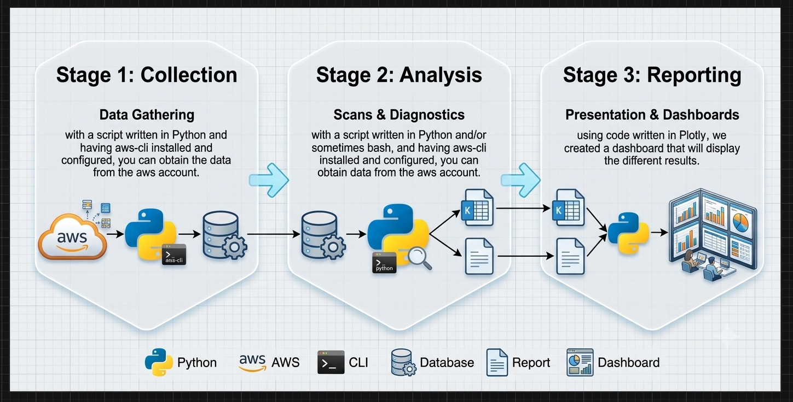

# Security dashboard 📝

This repository contains a security dashboard built with Plotly, Dash, and Python. It visualizes the results from scan reports, reading multiple CSV files that include data on IP addresses, domains, open ports, and other security metrics to facilitate monitoring and analysis.

<!-- TODO: add a screenshot of the running dashboard, e.g.  -->

## Reports

| Tab | What it shows |
| --- | --- |
| **Report IPs** | Number of open ports per scanned public IP |
| **Public IP: Open ports** | Public IPs exposing risky ports (SSH, RDP, Telnet, FTP, MySQL, PostgreSQL, WinRM) |
| **Header Report** | Domains with each security header present or missing |
| **IAM: users and permissions** | Users per IAM group and the full user list |

Reports read the CSV files every time a tab is opened, so updated scan results show up without restarting the app.

## What are the steps we follow to collect information on this control panel?



## Folder structure

```text
Security.Dashboard/
├── app.py                  # Dash application
├── requirements.txt
├── stages.png              # Data collection diagram
├── assets/
│   ├── styles.css
│   └── img/
└── data/                   # Example CSV files
    ├── scan_publicips_results.csv
    ├── verified_headers_results.csv
    └── iam_users_results.csv
```

## Data format

Replace the example files in `data/` with your own scan results, keeping the file names and these columns. Any extra columns are shown in the report tables.

| File | Required columns | Notes |
| --- | --- | --- |
| `scan_publicips_results.csv` | `Public_IP`, `OpenPorts` | `OpenPorts` as a list, e.g. `"[22, 80, 443]"` or `"22, 80, 443"` |
| `verified_headers_results.csv` | `X-Content-Type-Options`, `X-Frame-Options`, `Content-Security-Policy`, `Hsts` | Use `Missing` (or leave empty) when a header is not set |
| `iam_users_results.csv` | `Groups` | |

If a file is missing or a required column is not present, the tab shows an error message and the details are written to `dashboard.log`.

## Setup

1. Create and activate a virtual environment (recommended) ⚙️

    ```bash
    python -m venv .venv

    # Windows
    .venv\Scripts\activate

    # Linux / macOS
    source .venv/bin/activate
    ```

2. Install dependencies 🛠️

    ```bash
    pip install -r requirements.txt
    ```

## Run project 🚀

```bash
python app.py
```

Then open <http://127.0.0.1:8050> in your browser.

To enable Dash debug mode (hot reload and error overlay), set `DEBUG=true`:

```bash
# Windows (PowerShell)
$env:DEBUG="true"; python app.py

# Linux / macOS
DEBUG=true python app.py
```

## Author

By Agustina Fassina
